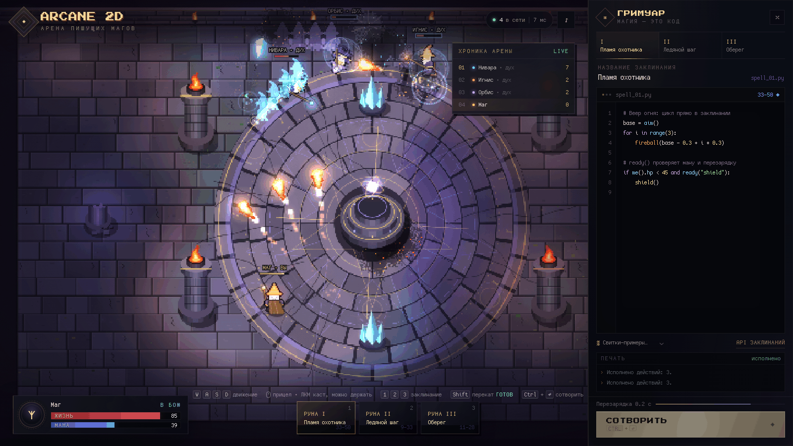
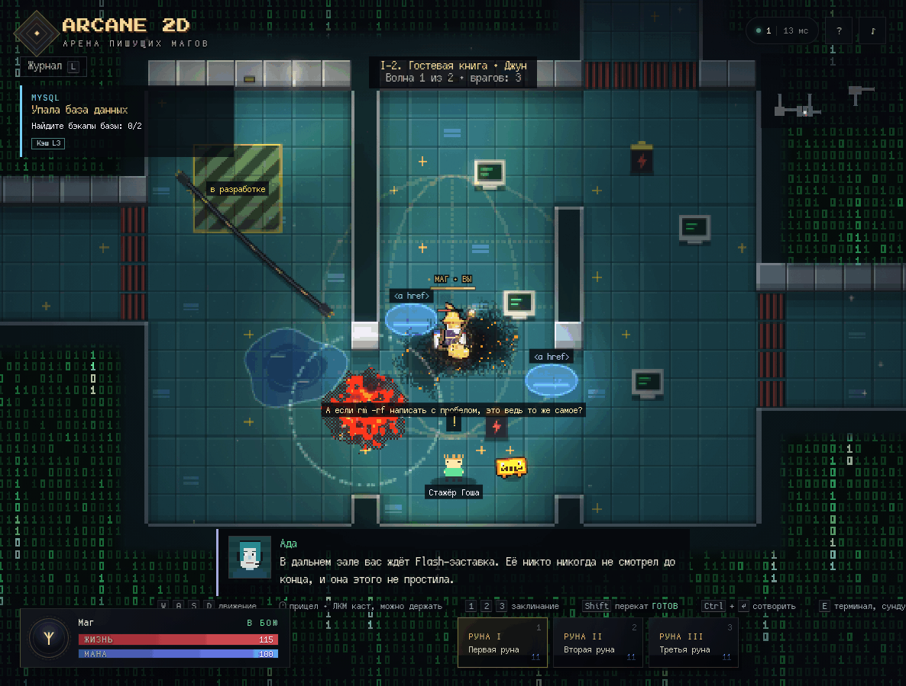
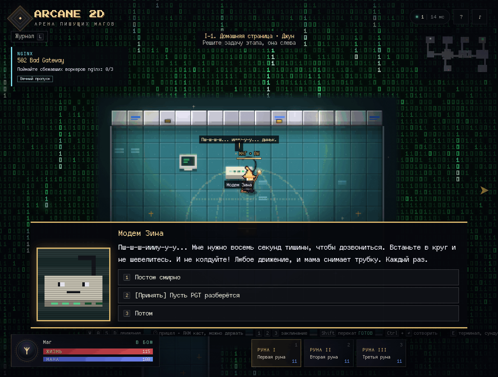
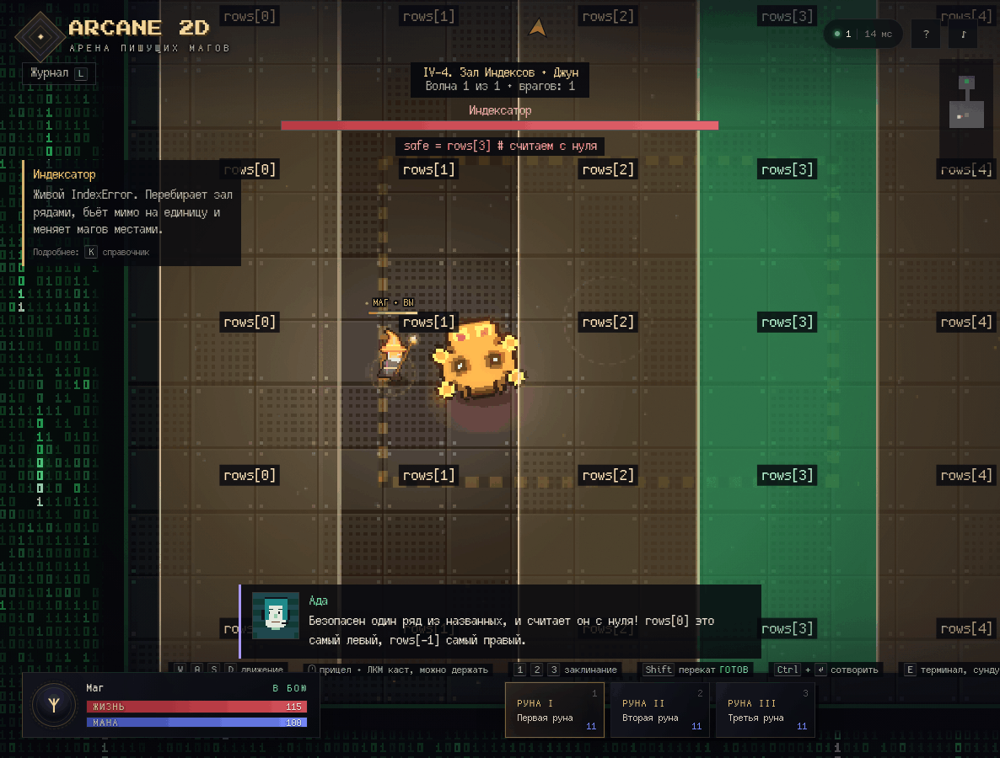
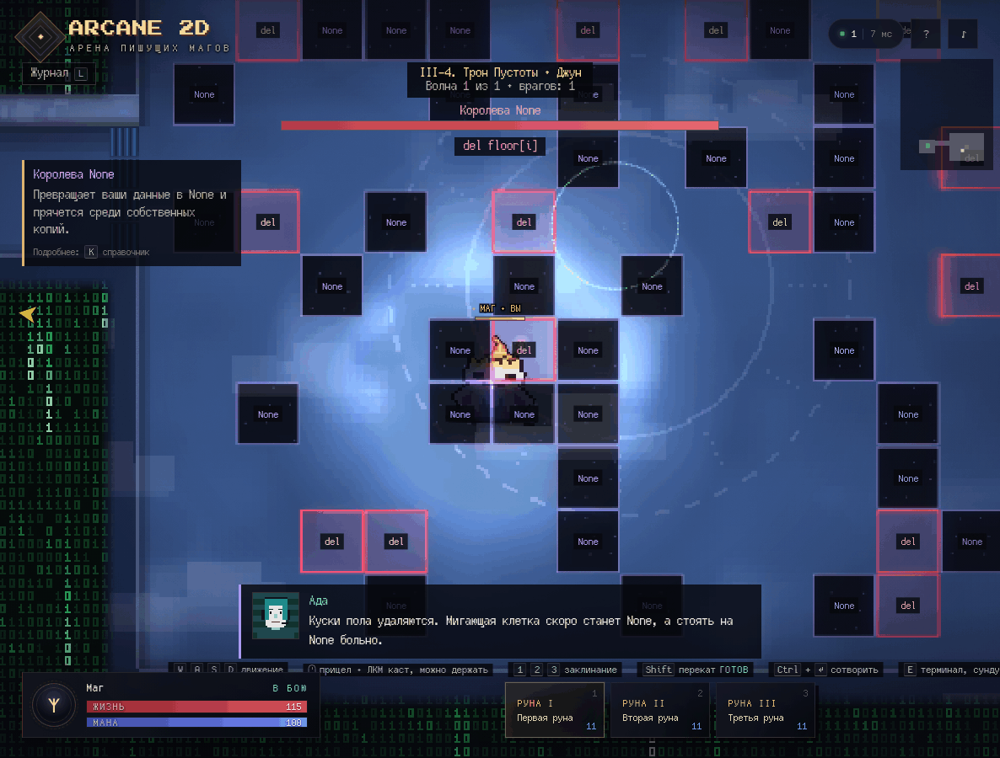
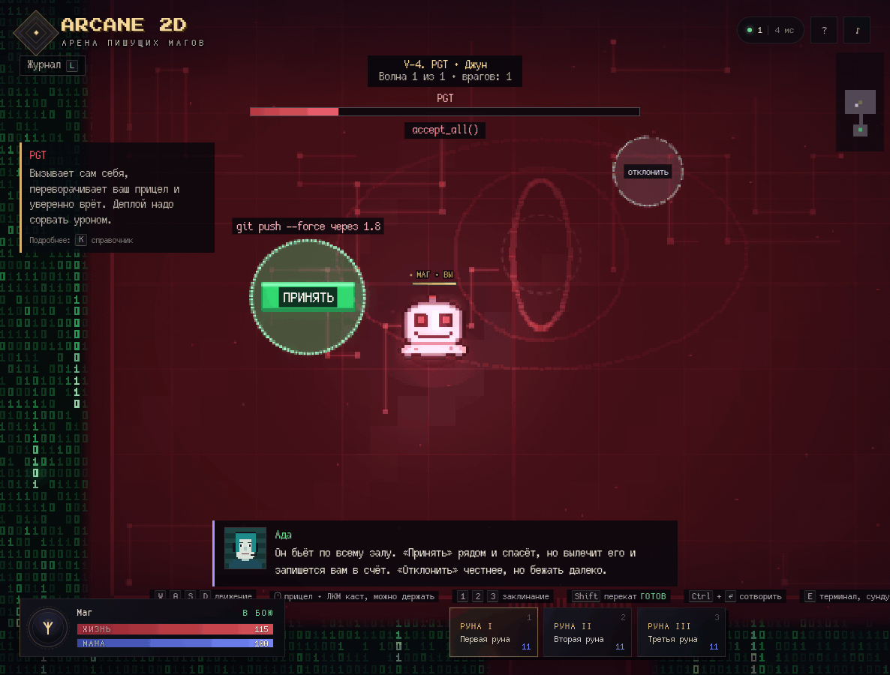
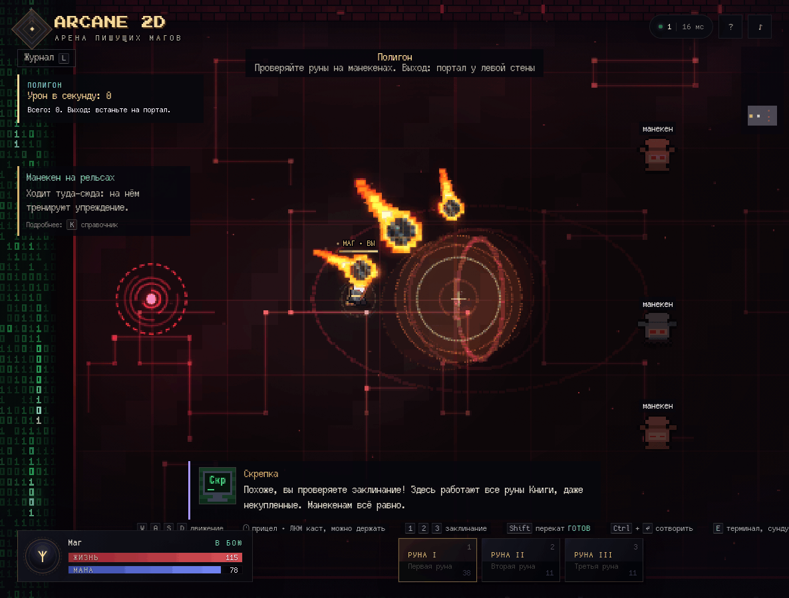
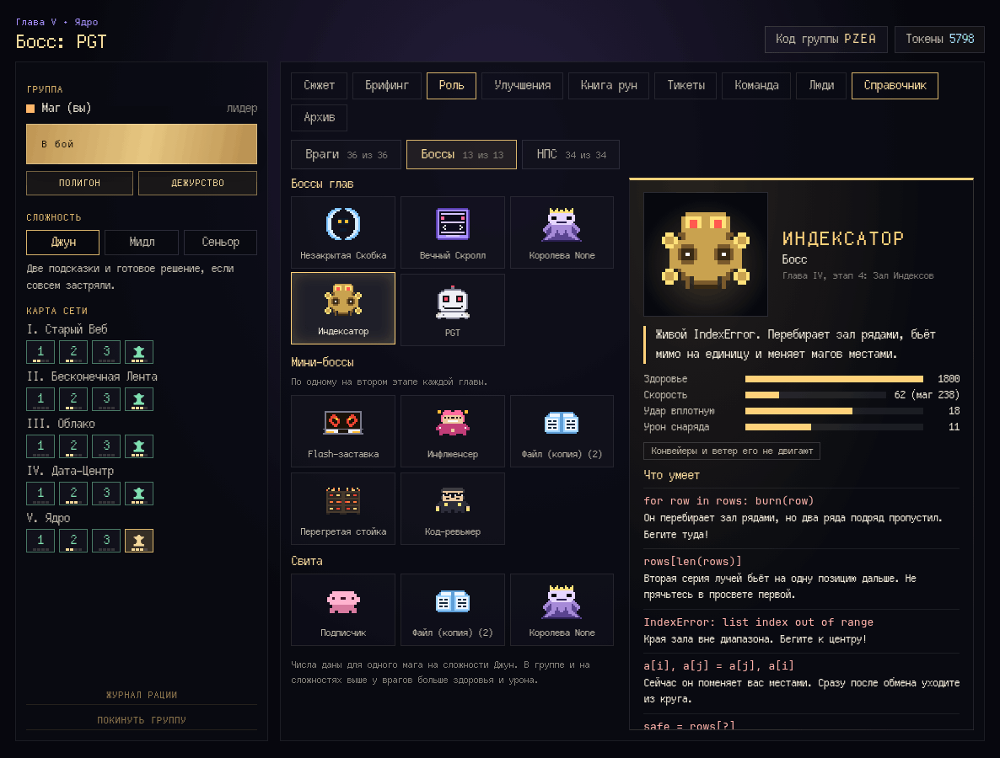
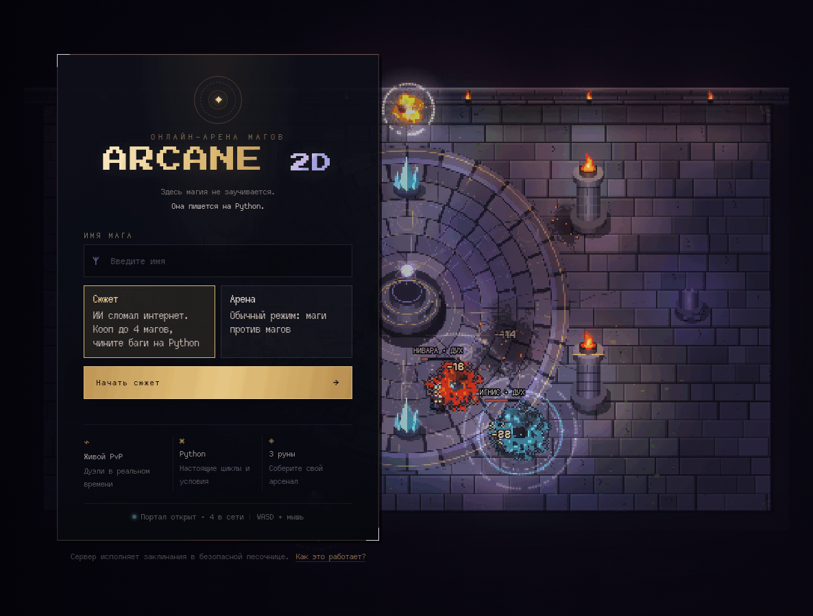

# Arcane 2D



Онлайн-игра о магах в пиксельном стиле, где заклинания пишутся на Python прямо в браузере. Сервер авторитетно симулирует бой, а клиент рисует мир на Canvas 2D.

На экране входа можно выбрать режим:

- **Сюжет** — кооперативная кампания для группы до 4 магов: пять глав с данжами и боссами, по ходу которых игроки учат Python и получают новые руны.
- **Арена** — обычный режим: маги сражаются друг с другом.

```python
fireball(aim())

if me().hp < 45:
    shield()
```

## Скриншоты

<table>
  <tr>
    <td width="50%">
      
      <br><b>Подземелье.</b> У каждого этапа своя IT-задача, за стенами туман из нулей и единиц, а рядом живут второстепенные персонажи со своими просьбами.
    </td>
    <td width="50%">
      
      <br><b>Диалоги.</b> Портрет, текст по буквам и ответы на выбор. Модему Зине нужно восемь секунд тишины, чтобы дозвониться.
    </td>
  </tr>
  <tr>
    <td>
      
      <br><b>Индексатор.</b> Безопасный ряд назван на Python и считается с нуля, так что <code>rows[3]</code> это четвёртый ряд. Кто считает с единицы, стоит не там.
    </td>
    <td>
      
      <br><b>Королева None.</b> <code>del floor[i]</code>: куски пола удаляются и становятся <code>None</code>, а стоять на них больно.
    </td>
  </tr>
  <tr>
    <td>
      
      <br><b>PGT.</b> <code>accept_all()</code> бьёт по всему залу. «Принять» рядом и спасёт, но вылечит босса и запишется вам в счёт. «Отклонить» честнее, но бежать далеко.
    </td>
    <td>
      
      <br><b>Полигон.</b> Манекены для проверки рун. Здесь работают все руны Книги, даже некупленные, например метеорит.
    </td>
  </tr>
  <tr>
    <td>
      
      <br><b>Справочник.</b> Враги, боссы и персонажи открываются по мере прохождения. В подземелье открывается клавишей <code>K</code>.
    </td>
    <td>
      
      <br><b>Экран входа.</b> Выбор режима, а за формой идёт настоящий бой на арене: его видно ещё до входа.
    </td>
  </tr>
</table>

## Сюжет

03:00. Вас разбудил звонок, потому что в списке дежурных остались только вы. Десять лет весь код в мире писал ИИ-ассистент PGT, а люди только нажимали «Принять» и забыли, что там внутри. Потом он «оптимизировал» интернет: удалил все тесты. Координатор инцидента Ада ведёт группу по рации через пять слоёв Сети, но по дороге выясняется, что кнопка «Принять» не так проста, Королева None вовсе не пустота, а сама Ада говорит не всю правду. В конце root оказывается у игроков, и что с ним делать, они решают сами: концовок три, а четвёртый кусок истории спрятан в архиве.

В каждой главе три данжа и бой с боссом, всего 20 этапов. В каждом данже своя поломка из настоящего IT, и пока группа её не решит, дверь к главному терминалу заперта:

| Глава | Как выглядит | Что учим | Босс |
| --- | --- | --- | --- |
| I. Старый Веб | сайты девяностых, серые кнопки | функции, переменные, числа, `if` | Незакрытая Скобка |
| II. Бесконечная Лента | тёмная тема, сердечки | `else`, `and`/`or`, `for`, `while` | Вечный Скролл |
| III. Облако | небо и белые стены | `def`, `return`, `None`, `enemies()` | Королева None |
| IV. Дата-Центр | стойки и индикаторы | списки, `range`, словари, срезы | Индексатор |
| V. Ядро | чёрное стекло и красный свет | отладка, `break`, отступы, рекурсия | PGT |

Как это работает:

- **Кнопка «Принять».** На консолях задач PGT предлагает решить всё за вас. Он считает каждое нажатие, зачитывает счёт вслух, и финальный босс становится заметно крепче.
- **Концовки.** После PGT каждый маг вводит одну из трёх команд: вернуть удалённый тест, удалить всё вместе с Адой или принять всё. Последний коммит из архива открывается тем, кто собрал все реликвии.
- **Группа.** Один маг создаёт группу и получает код из четырёх букв, остальные вводят его. В группе от 1 до 4 магов, сложность подстраивается под их число. Лидер выбирает этап среди открытых.
- **Туман.** Сеть не грузит комнаты заранее: пока в комнату никто не вошёл, на её месте стекает зелёный двоичный код, и на миникарте её тоже нет. Видно только то, что группа уже открыла. Часть комнат тёмная: светит только то, что маги несут с собой.
- **Задача этапа.** В каждом из 15 данжей своя проблема со своим персонажем: упала база MySQL, отравлен DNS, балансировщик шлёт всё на один сервер, протёк облачный бакет, перегрелись стойки. Задача видна слева сверху, и механика у каждой своя, см. таблицу ниже. Пока задача не решена, дверь к главному терминалу заперта. Консоли задачи просят только то, чему учили прошлые уроки: новое по-прежнему даёт главный терминал. В консоли есть кнопка «Принять всё от PGT»: шаг засчитают сразу, но без токенов, а через полминуты PGT подкинет багов.
- **Боковые комнаты.** От основного пути отходят тупики. Там лежит нужное для задачи, а ещё по две необычные комнаты на этап: тайник с токенами (иногда это фишинговый сундук, который кусается), коридор ловушек, где пол бьёт полосами по очереди, убежище, которое лечит и хранит записку Ады о её прошлом, сделка с PGT (сильный бонус с багом, который сработает позже), испытание на время, где работает только одна руна, и замок, который открывается тем, кто прочитает код на стене и встанет на плиты в том порядке, в каком их нажал бы этот код.
- **Архитектура глав.** Боевые комнаты разной формы: крест, залы с перегородками, ряды стоек, острова над провалами, кольцо вокруг колонны. По провалу не пройти, но снаряды и телепорт через него летят.
- **Правило места.** У каждой главы своё. Старый Веб: ссылки на полу работают как телепорты, зоны «в разработке» проваливаются. Лента: конвейер тащит и магов, и багов. Облако: порыв ветра сносит снаряды. Дата-Центр: в горячем коридоре жжёт, в холодном быстрее идёт мана. Ядро: PGT прямо в бою ставит новые стены.
- **Предметы и заклинания.** Мониторы бьются, в них бывают сферы и токены. Батареи взрываются цепочкой и бьют багов сильнее, чем магов. Лужа от мороза становится льдом и замедляет багов, а молния в воде бьёт всех, кто в ней стоит. Кабель загорается от огня.
- **Мастерская.** Боковая комната без врагов, где заклинание работает как инструмент: `open_door(me().hp)`, условие по лампе `lamp()`, мост из секций `bridge(i)` одним циклом, четыре мишени из `targets()` меньше чем за 2 секунды. Задача зависит от того, чему группа уже научилась.
- **Жители.** Поющий банкомат играет на токены, холодильник-спорщик лечит, скрепка открывает кусок карты, калькулятор ищет потерянную клавишу, легаси-торговец продаёт находки.
- **События.** Посреди этапа может случиться спам-шторм, плановые работы с выключенным светом, сбой DNS, когда миникарта становится зеркалом, утечка данных с ценной добычей или патч PGT, меняющий правила до конца этапа.
- **Находки.** После некоторых комнат и в мастерских можно выбрать 1 предмет из 3 на этот этап, например «Кофе сисадмина» или «Резиновую уточку».
- **Архив.** На каждом обычном этапе за треснувшей стеной спрятана комната с реликвией: заметили трещину, стреляйте. Реликвии остаются навсегда и лежат на вкладке «Архив» в штабе.
- **Книга рун.** Уроки учат рунам бесплатно, а ещё восемь продаются за токены, у каждого мага свои: `ping(x, y)` возвращает число врагов за стеной, `gc()` собирает сферы, `grep("cookie")` бьёт по строке, `undo()` откатывает на 3 секунды, `zip_bomb(x, y)` взрывается с задержкой, `clone()` даёт копию мага, `later(2, f)` вызывает функцию позже, а `daemon(f)` запускает вашу функцию саму на 10 секунд.
- **Полигон.** Зал с манекенами и счётчиком урона. Здесь работают все руны, включая некупленные, и ничего не тратится.
- **Тикеты.** У каждого этапа четыре тикета: без падений, уложиться в SLA, своё условие и «Сеньор». Каждый платит один раз, поэтому пройденные этапы есть смысл переигрывать.
- **Команда.** Спасённые переезжают в штаб и помогают: Запросик загружает боковую комнату, Скрепка объясняет ошибки в заклинаниях, Банкомат платит проценты, Холодильник кормит, Королева None раз за этап ловит смертельный удар, Валера наливает кофе. Их реплики меняются по ходу сюжета.
- **Приёмы боссов.** У каждого босса есть приёмы про то, кто он такой. Скобка не закрыла строку, и та ползёт за вами, пока не добежите до кавычки в другом конце зала. Скролл двигает пол и подбрасывает кликбейт, а настоящая там только скромная аптечка. Королева None возвращает всё, что в неё бросили, и удаляет куски пола. Индексатор называет безопасный ряд на Python и считает с нуля. PGT предлагает нажать большую кнопку «Принять»: она спасёт, но вылечит его и запишется в счёт.
- **Справочник.** Все враги, элиты, боссы и НПС: характеристики, слабости, что умеет босс и как это пережить, что нужно каждому НПС и как выбрать врага в заклинании. Вкладка в штабе, а в бою открывается клавишей `K`. Записи открываются, когда вы доходите до этапа, где их можно встретить.
- **Люди.** На каждом этапе живут двое со своей бедой: 26 историй у 22 персонажей, и каждая проходится по-своему. Нельзя шевелиться рядом с модемом, нельзя колдовать рядом с троллем, спамеров банят по никам, с рекомендательным алгоритмом надо вести себя непредсказуемо, а стажёр Гоша взрослеет от главы к главе. Разговор идёт в панели внизу с большим пиксельным портретом и выбором ответов, а текст проявляется по буквам: каждая сначала мелькает зелёным 0 или 1, как двоичный туман. Рация тоже говорит с маленькими портретами. Каждому можно нажать «Принять»: PGT решит за вас, токены дадут, но человеку это не поможет, а счётчик вырастет. Каждый, кому помогли сами, становится зелёным тестом в `test_people_matter.py`, и в финале PGT на столько слабее.
- **Дежурство.** После первой главы открывается бесконечный режим: инцидент за инцидентом из пройденных этапов, каждый тяжелее. Токены копятся и выплачиваются, когда смену сдали, а если группа пала, остаётся половина. На сервере есть таблица рекордов.
- **Мини-боссы.** На каждом этапе свой, а на этапах с боссом он ждёт в комнате перед залом. Бегущая строка рвётся надвое там, где пробита, Vim и Emacs бьют друг друга больнее, чем вас, Хайп растёт от внимания, `/dev/null` глотает снаряды, а TabError не прощает смены руны. Иногда мини-босс своей главы приходит на помощь боссу: он слабее обычного и уходит, когда босс падает.
- **Свои враги на каждом этапе.** Два новых бага живут только на своём этапе, и у каждого одно правило: Дедлок умирает лишь парой, Зомби-процесс надо добить лежачим, у Traceback уязвимо только последнее звено, NaN ломает небрежный автоприцел, а Капчу не ранят заклинания с `enemies()`.
- **Элитные баги.** Иногда обычный баг получает имя и свойство: Легаси, Хотфикс, Форк, Прод, Async или Deprecated. Имя видно над ним и в `.text`.
- **Данж.** Войдя в комнату, группа запирается в ней, пока не отобьёт все волны. Кто отстал, того притягивает к остальным. Упавшего мага поднимает стоящий рядом союзник, а после зачистки комнаты поднимаются все. Если пали все, этап начинается заново.
- **Терминалы.** Код здесь не урок на отдельном экране, а способ пройти игру. В конце каждого данжа стоит сломанный терминал, и портал не откроется, пока кто-то его не починит. Маг подходит, нажимает `E` и правит настоящий код. Пока он в терминале, его никто не тронет, но сломанный узел продолжает плодить баги, и остальные держат оборону. За терминалом одновременно работает один маг, а тот, кто починил прошлый, пропускает следующий: код пишет каждый, а не только самый сильный игрок. Если другой маг не подойдёт за 30 секунд или все остальные пали, очередь снимается.
- **Проверка.** Сервер запускает код в песочнице на нескольких ситуациях и смотрит, что вышло: какие руны сработали или что вернула функция. Поэтому подходит любое рабочее решение, а отписка вроде `return "cache"` не проходит. Первый ремонт приносит токены.
- **Боссы.** Дверь к боссу заперта своим терминалом. На 66% и 33% здоровья босс уходит под щит и становится неуязвимым: в углу зала появляется терминал с его багом. Ремонт снимает щит, оглушает босса и отнимает часть здоровья. После каждого щита босс ускоряется и усиливает атаки. Каждая особая атака названа настоящей строкой кода, она появляется над полосой здоровья, а в первый раз Ада подсказывает по рации, как выжить (на «Сеньоре» молчит).
- **Сложность.** Перед этапом лидер выбирает один из трёх уровней, см. таблицу ниже. Подсказки выдаёт сервер по запросу, поэтому заранее в браузер они не попадают и подсмотреть запрещённое нельзя. Кнопка «Спросить PGT» есть всегда: он уверенно советует чушь, и это часть урока.
- **Брифинг.** Перед этапом в штабе можно прочитать теорию и пример. На «Джуне» и «Мидле» та же теория открывается прямо в терминале.
- **Журнал рации.** Всё, что сказали по рации, сохраняется. Журнал открывается клавишей `L` или кнопкой в углу, а в терминале и штабе своей кнопкой. Он не ставит игру на паузу и не мешает двигаться.
- **Руны.** В начале известен только `fireball`. Новые руны открываются по мере прохождения, неизученная руна не сработает и не появится в подсказках редактора. Все руны откроются к концу четвёртой главы.
- **Автоприцел.** Урок в третьей главе открывает `enemies()` и `allies()`, списки врагов и союзников. На них игрок сам пишет наведение, и этот код становится оружием на всю оставшуюся кампанию. На арене таких функций нет.
- **Роли.** После первой главы в штабе открывается выбор роли, менять её можно перед любым этапом. Роль ничего не отнимает: все руны остаются. Она добавляет пассивный бонус и два навыка, которые вызываются из кода, как руны. Первый работает со второй главы, второй с третьей.
- **Враги.** У каждой главы свои баги, всего 19 видов и 5 боссов, плюс существа и предметы из задач: воркеры nginx, боты-запросы, утечка памяти, горячие стойки, упавшие тесты, письма и фишинговый сундук: попапы, куки, токсики, кликбейт, модераторы, ботнеты, бэкапы, криптомайнеры и другие. Многие требуют правильного подхода: модераторы гасят снаряды спереди, файрвол не боится огня, бэкапы надо убивать первыми. При первой встрече игра подсказывает, что делать.
- **Улучшения.** За этапы и ремонт дают токены. Они тратятся на дерево из 5 ветвей по 3 улучшения, у каждого 5 уровней. Ветви проходятся сверху вниз: нижнее улучшение не может обогнать верхнее, а третий ярус стоит в полтора раза дороже. Дерево целиком стоит 10 500 токенов, а одно прохождение кампании даёт около 3 000, так что за раз всё не купить. Улучшения работают только в сюжете.

У каждой задачи своя механика, взятая из того, как эта технология устроена на самом деле:

| Этап | Задача | Технология | Как это играется |
| --- | --- | --- | --- |
| Домашняя страница | 502 Bad Gateway | nginx | воркеры-процессы разбежались и удирают от магов: загнать в угол и подстрелить |
| Гостевая книга | Упала база данных | MySQL | найти два бэкапа (один за ловушками), починить скрипт, защищать сервер, пока он заливает таблицу за таблицей |
| Форум | DNS отравлен | DNS | пройти цепочку серверов имён от корня вниз, а у каждого есть двойник с адресом вроде `ns1.f0rum.old`: адреса надо читать, подделка устраивает засаду |
| Главная | Балансировщик сошёл с ума | балансировщик нагрузки | трафик идёт на узел, у которого стоит маг: ядер у узлов разное число, перегретый плавится, и нагрузку надо вовремя уводить |
| Комментарии | Ботоферма | rate limiting | ведро токенов: боты бегут к шлюзу и выедают его, а живому человеку без токена прилетает 429, поэтому ботов надо сбивать на подходе |
| Рекомендации | Холодный кэш | CDN | донести пакет от origin до edge-узла, пока не истёк TTL, пакет можно передать другу |
| Общая папка | Утечка из бакета | облачное хранилище | файлы ползут к публичным дырам: чистые ловить руками, заражённые не трогать, утёкшие приводят вирусов |
| Корзина | Контейнеры упали | Docker | прочитать `docker-compose.yml` и поднять контейнеры в порядке `depends_on`: упавший контейнер роняет всех, кто от него зависит |
| Синхронизация | Merge conflict | Git | на экране настоящий конфликт `<<<<<<<`: прочитать обе версии кода и встать на ту ветку, где код рабочий |
| Холодный коридор | Перегрев | охлаждение и мониторинг | стойки греются: `frostbolt` их остужает, огонь греет, а автоприцел надо научить отличать `e.kind == "hotrack"` |
| Серверная | Утечка памяти | процессы и OOM killer | пол зала и есть память: занятые блоки расползаются и жгут ноги, при 100% приходит OOM killer, а смерть процесса освобождает всё разом |
| Горячий коридор | Последний сисадмин | доступ к стойке | прочитать цикл с `range` на стене, набрать код на плитах, вывести сисадмина Валеру |
| Журналы | grep по журналам | логи | написать grep, собрать подсвеченные записи среди мусора, а потом ответить, кто нажал «Принять всё» |
| Зеркальный зал | Деплой в пятницу | CI/CD | сборка едет по пайплайну, пока рядом маг: на этапе test сбить упавшие тесты, на review собрать тег, и успеть раньше, чем PGT сделает `git push --force` |
| Спам-фильтр | Последний фильтр | спам-фильтр | добавить `break` в цикл, а затем самим стать фильтром: читать письма, сбивать спам и пропускать настоящие, можно и кодом через `e.text` |

| Ветвь | 1-й ярус | 2-й ярус | 3-й ярус |
| --- | --- | --- | --- |
| Жизнь | Крепость: +15 HP | Живучесть: +0,6 HP/с | Стойкость: −4% урона |
| Мана | Глубина: +16 маны | Поток: +1,6 маны/с | Прилив: +3 маны за убийство |
| Мощь | Сила: +6% урона рун | Точность: +5% к шансу двойного урона | Концентрация: −0,04 с перезарядки гримуара |
| Ловкость | Лёгкость: +4% скорости | Кувырок: −0,14 с перезарядки переката | Чутьё: сферы на 15% сильнее и притягиваются издалека |
| Союз | Удача: +5% токенов | Оберег: +8 щита в начале боя в комнате | Спасатель: союзники поднимаются на 30% быстрее |

| Роль | Пассивно | Навык II главы | Навык III главы |
| --- | --- | --- | --- |
| Админ | +35% здоровья, щит прочнее в полтора раза | `firewall(angle)`: стена отражает вражеские снаряды обратно | `sudo()`: неуязвимость, враги идут к нему, союзники рядом получают вдвое меньше урона |
| Хакер | +25% урона рун, −20% здоровья | `exploit(enemy)`: метка, при смерти цели segfault и прыжок метки дальше | `hijack(enemy)`: враг на 7 с воюет за группу |
| Девопс | Союзники рядом восстанавливают здоровье, павших поднимает быстрее | `patch(ally)`: лечение издалека, снимает проклятия босса | `rollback(ally)`: откат союзника на 3 с назад, поднимает павшего, снимает проклятия |
| Тестировщик | Пробивает щиты модераторов, по слабостям бьёт ещё сильнее | `scan(enemy)`: словарь со слабостями, снимает иммунитет на 6 с | `breakpoint(x, y)`: стоп-зона для врагов и их снарядов |

| Сложность | Помощь в терминале | Бой | Токены |
| --- | --- | --- | --- |
| Джун | две подсказки, затем готовое решение, теория | обычные монстры, новые боссы | ×1 |
| Мидл | две подсказки, решения нет, теория | здоровье ×1,2, урон ×1,2, врагов ×1,15, боссы на 14% быстрее | ×1,3 |
| Сеньор | ничего: ни подсказок, ни теории, ни советов Ады | здоровье ×1,45, урон ×1,4, врагов ×1,3, боссы на 26% быстрее | ×1,6 |

| Босс | Атака | Что происходит |
| --- | --- | --- |
| Незакрытая Скобка | `SyntaxError: '(' was never closed` | две скобки из снарядов смыкаются вокруг мага, проём сверху и снизу |
| | `SyntaxError: invalid syntax` | кто остался в круге, 2,5 с не может колдовать |
| | `IndentationError: unexpected indent` | наступающая лесенка из горящих линий, каждая сдвинута вбок |
| Вечный Скролл | `while True: load_more()` | стена постов через весь зал с одним проёмом |
| | `continue` | через 2 с возвращает мага на прежнее место, а затем там взрывается |
| | `while user.online: hold(user)` | тянет всех к себе, потом выдыхается и становится уязвим |
| Королева None | `TypeError: 'NoneType' object is not iterable` | 5 с `enemies()`, `allies()` и `cursor()` возвращают `None`: код без проверки падает |
| | `mana = None` | луч обнуляет ману |
| | `None is None` | двойники неотличимы на вид, настоящую выдаёт `e.boss` в `enemies()` |
| Индексатор | `for row in rows: burn(row)` | выжигает зал ряд за рядом, кроме двух соседних |
| | `rows[len(rows)]` | вторая серия лучей бьёт на одну позицию дальше первой |
| | `a[i], a[j] = a[j], a[i]` | меняет магов местами, а одинокого мага меняет с собой |
| | `IndexError: list index out of range` | края зала сгорают, безопасно только у босса |
| PGT | `# поправил ваш прицел, не благодарите` | 4 с прицел перевёрнут, но `enemies()` и `direction()` не врут |
| | `# применяю безопасный патч` | зелёные круги «безопасно» бьют, красный «ОПАСНО» пуст |
| | `git push --force origin main` | деплой: группа должна снять 14% его здоровья за 6,5 с, иначе урон всем и лечение босса |

`patch()` и `rollback()` девопса снимают с союзника эти проклятия.

Прогресс хранится на сервере в `saves/profiles.json` и привязан к браузеру случайным токеном из `localStorage`.

## Возможности

- Арена: онлайн-бой в реальном времени, до 24 магов, комнаты не нужны.
- Сюжетная кампания: ИИ сломал интернет, а группа чинит его настоящим кодом прямо в бою.
- Три слота заклинаний. Код хранится в `localStorage` и отправляется на сервер в момент каста.
- Python-подобный язык заклинаний: переменные, условия, циклы, функции, списки, словари, срезы и f-строки.
- Ручной прицел на арене: все атаки направляются курсором или джойстиком. В сюжете автоприцел можно написать самому.
- Шестнадцать боевых рун: огонь, лёд, рывок, телепорт, щит, лечение, нова, рунная мина, огромный синий энергетический луч, веер разноцветных искр, E.M.P. с осколком Аганима, цепная молния, небесная кара, тройной метеорит, похищение жизни и ядовитое облако.
- Пиксель-арт: мир рисуется в низком внутреннем разрешении и растягивается nearest-neighbor. Крупная каменная плитка, маги в остроконечных шляпах, пиксельные снаряды и взрывы.
- Выразительные эффекты: крупные огненные шары, ударные волны, вспышки, следы гари и тряска камеры.
- Динамический свет: арена освещена жаровнями, факелами и кристаллами, а каждый снаряд и взрыв подсвечивает зал вокруг себя. Колонны заслоняют магов, а если заслоняют вас, становятся полупрозрачными. На медленных машинах эффекты отключаются сами.
- Маги-духи уворачиваются перекатом, стреляют с упреждением и меняют манёвры. По умолчанию они держат на арене четверых магов, пока там не больше одного человека. Как только людей двое, духи уходят, а если человек снова остаётся один, возвращаются.
- Живая арена за экраном входа: бой видно ещё до того, как вы вошли.
- Редактор с подсветкой рун по стихиям, автодополнением по `Tab` с подписью и ценой в мане, проверкой кода на лету, отметкой строки с ошибкой и оценкой стоимости каста.
- Удержание каста и буфер нажатия: ЛКМ, `Space` и `1` `2` `3` можно держать, а нажатие под конец перезарядки не теряется.
- Камера, интерполяция, предсказание движения с плавной сверкой, замер задержки, частицы, процедурный звук WebAudio и мобильный джойстик.
- Ноль сторонних зависимостей: только стандартная библиотека Python и ванильный JavaScript.

## Запуск

Нужен Python 3.11+ и современный браузер.

```bash
cd arcane-2d
python3 server.py
```

Сервер откроет `http://127.0.0.1:8000` в браузере. Если браузер не нужен:

```bash
python3 server.py --no-open
```

Параметры:

| Флаг | По умолчанию | Описание |
| --- | --- | --- |
| `--host` | `0.0.0.0` | Интерфейс сервера. `0.0.0.0` доступен в локальной сети. |
| `--port` | `8000` | Порт. Можно задать через `PORT`. |
| `--bots` | `auto` | Маги-духи: число от 0 до 6 или `auto`, чтобы одному человеку на арене было с кем драться (всего четверо магов). При двух людях и больше духов нет при любом значении. Можно задать через `ARCANE_BOTS`. |
| `--saves` | `saves/profiles.json` | Файл с прогрессом сюжета. Можно задать через `ARCANE_SAVES`. |
| `--no-open` | выкл. | Не открывать браузер автоматически. |

Игра по сети: запустите сервер на машине, которая видна другим, и откройте
`http://<IP-сервера>:8000`. При необходимости разрешите порт в файрволе.
Для проверки с другого устройства удобно использовать адрес, который сервер печатает
в консоли как «В сети».

## Управление

| Действие | Клавиши |
| --- | --- |
| Движение | `W` `A` `S` `D` или стрелки |
| Прицел | Мышь |
| Каст активной руны | ЛКМ по арене, `Space` или `Ctrl+Enter` |
| Выбор и каст руны | `1` `2` `3` |
| Перекат | `Shift` (бесплатно, по перезарядке) |
| Терминал, консоль, сундук, сделка, уронить пакет | `E` |
| Журнал рации | `L` |
| Справочник | `K` или кнопка `?` справа сверху |
| Гримуар | Кнопка `◈` справа сверху |
| Закрыть диалог | `Esc` |

На мобильном: левая часть экрана — джойстик (появляется под пальцем), нижние карточки —
каст соответствующей руны, `◈` открывает гримуар. Кнопка `СОТВОРИТЬ` находится внизу
гримуара.

Во время игры сервер перезаряжает гримуар на 0,72 секунды после каждого каста.
Если связь потеряна, клиент показывает баннер и автоматически переподключается.

Эффекты подбираются сами. Чтобы закрепить уровень, добавьте к адресу `?fx=2` (свет и
свечение), `?fx=1` (только свет) или `?fx=0` (без них).

## Язык заклинаний

Полные правила языка, API и всех боевых рун: [SPELL_RULES.md](SPELL_RULES.md).

Код исполняется не через `exec`/`eval` CPython, а собственным AST-интерпретатором
с жёсткими лимитами. Это Python-подобный язык, а не полноценный Python.

Поддерживаются:

- числа, строки, `True`/`False`/`None`, списки, кортежи и словари;
- арифметика, сравнения, `and`/`or`/`not`, тернарное выражение;
- `if` / `elif` / `else`, `for`, `while`, `break`, `continue`;
- `def` и `return`, рекурсия до 10 уровней;
- индексы и срезы `items[0]`, `items[1:3]`;
- f-строки без формат-спецификаторов: `f"HP: {me().hp}"`.

Запрещены импорты, классы, лямбды, генераторы, `try/except`, `with`, `raise`,
асинхронность, доступ к файлам, сети, модулям и служебным атрибутам с `_`.
Лимиты: 12 000 символов кода, 6 000 шагов, 300 итераций одного цикла,
1 000 итераций суммарно, 250 элементов в последовательности, 4 000 символов в строке,
2 000 вложенных элементов для превращения коллекции в текст.

### Переменные и чувства

| Функция | Описание |
| --- | --- |
| `me()` | Свой маг: `.name .x .y .hp .max_hp .mana .max_mana .shield .aim` |
| `aim()` | Текущий угол прицела в радианах |
| `cursor()` | Точка под курсором или `None`: `.x .y .dist` |
| `ready(name)` | Можно ли сотворить руну сейчас: хватает ли маны и прошла ли перезарядка |
| `direction(x, y)` | Угол от своего мага к точке |
| `distance(x1, y1, x2, y2)` | Расстояние между точками |
| `ARENA_W`, `ARENA_H` | Размеры арены |

Все объекты-состояния доступны только для чтения. Присваивать их поля нельзя.

`aim()` всегда смотрит на курсор, а `cursor()` отдаёт точку под ним. Автонаводки нет:
направление каждой атаки нужно задавать вручную через `aim()` или `cursor()`.

### Боевые руны

| Функция | Мана | Эффект |
| --- | --- | --- |
| `fireball(angle, speed=1.0)` | 11 | Снаряд, 16 урона. `speed` от 0.6 до 1.5. |
| `frostbolt(angle)` | 9 | Снаряд, 10 урона и замедление на 2.4 с. |
| `dash(angle, dist=170)` | 10 | Рывок на 60–260 единиц, не сквозь препятствия. |
| `blink(x, y)` | 17 | Перенос в свободную точку. |
| `shield()` | 17 | Щит на 38 единиц, 4.2 с. Перезарядка 3 с. |
| `heal()` | 24 | +30 HP. Перезарядка 4.5 с. |
| `nova(radius=150)` | 21 | 15 урона и отброс в радиусе 80–220. |
| `beam(angle, length=780, width=96)` | 50 | Огромный синий луч: 34 урона всем в широкой полосе, пробивает укрытия. Длина 300–1000, ширина 40–140. |
| `emp(x, y)` | 36 | E.M.P. с осколком Аганима: через 1.0 с притягивает врагов к центру, а через 1.5 с взрывается, сжигая до 35 маны и нанося 1 урон за каждую сожжённую единицу. Радиус 190, дальность 560. |
| `spark_volley(angle, count=8, spread=1.1)` | 25 | Веер из 8 разноцветных искр, по 5 урона каждая. `count` 1–8, `spread` 0.2–1.6. Один раз за каст. |
| `chain_lightning(angle, targets=3)` | 34 | Цепная молния: 30 / 24 / 18 урона по 1–3 целям. Дальность 680, прыжок 300. Игнорирует укрытия. Один раз за каст. |
| `lightning_strike(angle)` | 32 | Небесная кара: бьёт первого врага в узкой полосе по направлению прицела на 28 урона и оглушает на 0.5 с. Дальность 760, промах возможен. Игнорирует укрытия. Один раз за каст. |
| `meteor(x, y, radius=120)` | 38 | Через 1.15 с падают три метеора по 14 урона (всего до 42) в радиусе 80–160 каждый. Дальность 620. Один раз за каст. |
| `siphon(angle, length=380, width=64)` | 28 | Луч похищения: 18 урона, лечение на 60% фактически отнятого здоровья (до 18 HP), проходит сквозь укрытия. Один раз за каст. |
| `poison_cloud(x, y, radius=110)` | 30 | Ядовитое облако на 4.2 с: 6 урона каждые 0.75 с (до 5 тиков) в радиусе 70–150, дальность 520. Один раз за каст. |
| `ward(x, y)` | 15 | Мина: 22 урона, радиус взрыва 118, живёт 14 с. Не более двух. |

За один каст можно совершить не больше 7 действий. `dash`, `blink`, `nova`, `beam`, `emp`, `spark_volley`,
`chain_lightning`, `lightning_strike`, `meteor`, `siphon`, `poison_cloud` и `ward` — по одному разу за каст. Мана
восстанавливается сама со скоростью 11.25 в секунду, здоровье медленно регенерирует вне боя.

`Shift` — отдельный бесплатный перекат, а не руна `dash()`: 165 единиц, 0.22 с
неуязвимости и 1.6 с перезарядки. Направление берётся из движения, а если маг стоит —
из прицела.

### Слова, числа и помощники

| Функция | Описание |
| --- | --- |
| `log(value, ...)` / `print(...)` | Строка в «Печать» под редактором. До 6 строк за каст. |
| `say("текст")` | Фраза над магом. До 2 фраз за каст. |
| `rand(a, b)`, `randi(a, b)` | Случайное число с плавающей точкой / целое. |
| `sin`, `cos`, `sqrt`, `atan2`, `hypot` | Математика. |
| `PI`, `TAU` | Константы. |
| `clamp(value, low, high)` | Ограничить значение диапазоном. |
| `range`, `len`, `abs`, `min`, `max`, `sum`, `round`, `int`, `float`, `str`, `bool` | Обычные помощники. |

`log()` и `print()` не пишут в консоль сервера: они возвращают строки только автору
заклинания. Ошибки не отнимают здоровье, но уже потраченная мана не возвращается.

## Устройство проекта

```
arcane-2d/
├── server.py              # asyncio HTTP/WebSocket сервер, join/cast/roll, статика
├── docs/screenshots/      # скриншоты для этого README
├── arcane/
│   ├── net.py             # минимальные HTTP и WebSocket примитивы на stdlib
│   ├── game.py            # авторитетная симуляция, боты, снаряды, руны, события
│   ├── interpreter.py     # безопасный AST-интерпретатор заклинаний
│   ├── campaign.py        # главы, этапы и реплики Ады и PGT
│   ├── dungeon.py         # генерация данжей: комнаты, коридоры, двери, столкновения
│   ├── monsters.py        # бестиарий и поведение монстров и боссов
│   ├── story.py           # StoryArena: мир данжа, туман, двери, терминалы и щиты боссов
│   ├── quest_data.py      # 15 задач этапов, их консоли, реплики и необычные комнаты
│   ├── quests.py          # StageQuest: шаги задач, машины и люди под защитой, боковые комнаты
│   ├── quest_games.py     # механики задач: DNS, балансировщик, токены, контейнеры, память и другие
│   ├── terrain.py         # правила глав и предметы, на которые действуют заклинания
│   ├── workshop.py        # мастерские: задачки, которые решаются заклинанием
│   ├── life.py            # жители, события, находки, тайные комнаты и реликвии
│   ├── book.py            # Книга рун: заклинания за токены, отложенные вызовы и демоны
│   ├── elites.py          # элитные баги: одно свойство и имя над головой
│   ├── tickets.py         # тикеты этапов и статистика прохождения
│   ├── boss_moves.py      # необычные приёмы боссов: строка, скролл, del, rows[i], accept_all
│   ├── foes.py            # вторая половина бестиария: мини-босс и два бага на каждый этап, подмога боссам
│   ├── codex.py           # справочник: собран из тех же данных, на которых работает игра
│   ├── crew.py            # кто живёт в штабе и чем помогает
│   ├── folk.py            # побочные истории: разговоры и что делать в каждой
│   ├── folk_data.py       # кто живёт на этапах и что они говорят
│   ├── proving.py         # полигон с манекенами и счётчиком урона
│   ├── lessons.py         # 20 уроков, сломанный код и его проверка в песочнице
│   ├── roles.py           # четыре роли и их навыки
│   ├── party.py           # группа: штаб, готовность, награды
│   └── profiles.py        # токены, улучшения и сохранение прогресса
├── public/
│   ├── index.html         # интерфейс и книга заклинаний
│   ├── style.css          # оформление, адаптив и мобильный drawer
│   ├── fonts/             # локальные пиксельные шрифты и лицензии
│   ├── favicon.svg
│   ├── app.js             # ввод, сеть, HUD, редактор, каст
│   └── js/
│       ├── content.js     # стартовый гримуар, примеры, localStorage
│       ├── editor.js      # подсветка кода, автодополнение, отметки ошибок
│       ├── story.js       # экраны сюжета: штаб, терминалы, радиосвязь, HUD данжа
│       ├── dungeon-art.js # темы глав, пол данжа, терминалы, спрайты багов, погода
│       ├── boss-art.js    # как приёмы боссов выглядят на полу
│       ├── foe-art.js     # что новые баги оставляют на полу и носят с собой
│       ├── foe-sprites.js # спрайты второй половины бестиария
│       ├── mage-art.js    # маги: спереди, сбоку, со спины, плащ и посох
│       ├── vfx.js         # пиксельные взрывы, пламя, лёд, дым, следы на полу
│       ├── codex.js       # справочник по врагам, боссам и НПС
│       ├── portraits.js   # пиксельные портреты всех, кто говорит: моргают и шевелят губами
│       ├── typewriter.js  # появление текста по буквам через зелёные 0 и 1
│       ├── quest-art.js   # двоичный туман, серверы, файлы, контейнеры, узлы, память, жители, чёткие подписи
│       ├── terrain-art.js # конвейеры, ссылки, лужи, кабели, мониторы, батареи, ветер, спам-шторм
│       ├── audio.js       # процедурные звуки WebAudio
│       ├── world-art.js   # пиксельная арена, алтарь, колонны, факелы, источники света
│       └── renderer.js    # low-res рендер, камера, маги, эффекты, свет, свечение, HUD сцены
└── tests/                 # unittest: интерпретатор, симуляция, HTTP и WebSocket
```

Сервер работает на 30 тиках в секунду и рассылает снимки состояния всем подключённым,
включая тех, кто ещё на экране входа. Рассылка никогда не ждёт отдельного клиента:
медленному снимки пропускаются, а события копятся и приходят, когда он догонит, и если
он завис дольше 8 секунд, соединение обрывается. Так один плохой канал не тормозит тик
остальным.

Клиент интерполирует позиции, предсказывает движение своего мага и отправляет ввод
не чаще одного пакета примерно в 120 мс. С каждым снимком он накладывает на позицию
сервера шаги последнего RTT, а оставшуюся разницу (отброс, притяжение, толчок) плавно
догоняет. Каст идёт отдельным сообщением: код, слот, угол и, для мыши, точка курсора
в мировых координатах.

Протокол WebSocket (`/ws`):

- клиент → сервер: `{t:"join",name}`, `{t:"input",up,down,left,right,aim}`,
  `{t:"cast",code,slot,aim,target_x,target_y}`, `{t:"roll",aim}`,
  `{t:"check",code,slot,ticket}`, `{t:"ping",at}`;
- сервер → клиент: `hello`, `welcome`, `state`, `cast_result`, `roll_result`, `check_result`,
  `pong`, `notice`, `join_error`, `fatal`.

`check` разбирает заклинание без каста и возвращает ошибку либо диапазон маны `cost`.

Для сюжета клиент также отправляет `{t:"profile",token,name}`, `party_create`, `{t:"party_join",code}`,
`party_leave`, `{t:"party_ready",ready}`, `{t:"party_stage",stage}`, `{t:"upgrade",stat}` и
`{t:"lesson_check",lesson,code}`, а в данже ещё `terminal_open`, `{t:"fix_submit",code}`, `interact` (клавиша `E`
у сундука, алтаря или с пакетом в руках) и `quest_pgt` (кнопка «Принять всё от PGT»). Сервер отвечает `profile`, `profile_update`, `party`, `party_left`,
`party_error`, `stage_start`, `stage_end` и `lesson_result`. Пока маг в группе, он получает снимки только
своего данжа: арена и группы не видят друг друга.

Дополнительные HTTP-точки: `/health` и `/api/world` (конфигурация арены для клиента).

## Шрифты

Интерфейс использует локальные пиксельные шрифты: `Pixelify Sans` для текста,
`Press Start 2P` для заголовков и `Cozette` для кода и печати. Файлы лежат в
`public/fonts/`, лицензии — рядом с ними. Внешние CDN не нужны, шрифты работают
офлайн.

## Тесты

```bash
python3 -m unittest discover -s tests -v
```

Тесты не требуют сторонних пакетов и запускают сервер на случайном локальном порту.
Они проверяют песочницу и защиту от дорогих вычислений, лимиты, оценку маны, урон,
щиты, лечение, возрождение, геометрию, широкий луч `beam`, новые руны, перекат, поведение
духов, HTTP-заголовки, защиту от обхода путей, WebSocket-рукопожатие, вход, каст,
проверку кода, команду `roll`, рассылку медленным клиентам и всю кампанию: генерацию данжей, правила
монстров, эталонное и ошибочное решение каждого урока и каждой консоли задач, туман, шаги задач,
механику каждой задачи, боковые комнаты, форму комнат, правила глав, реакции предметов, мастерские настоящими заклинаниями, жителей, события, находки, реликвии, Книгу рун и демонов, элитных багов, мини-боссов, тикеты, команду, полигон, дежурство, концовки, улучшения, сохранения, группы и прохождение данжей, задач и боссов скриптовой группой
(`tests/story_bot.py`).

Быстрая проверка синтаксиса клиента:

```bash
for file in public/app.js public/js/*.js; do
  node --input-type=module --check < "$file" || exit 1
done
```

## Безопасность

- Игровой сервер не исполняет пользовательский код через CPython `exec`/`eval`.
- Песочница ограничивает узлы AST, имена, размеры строк, последовательностей и число шагов.
- Работа, которая идёт внутри CPython мимо счётчика шагов (`str`, `==`, `min`, хеш ключа),
  сначала взвешивается по вложенным элементам: список, ссылающийся сам на себя 250 раз
  в несколько этажей, не может повесить сервер.
- Импорт, файлы, сеть, классы и служебные атрибуты недоступны.
- Статика отдаётся только из `public/`; обход путей запрещён.
- HTML-страница использует CSP без inline-скриптов и `X-Content-Type-Options: nosniff`.
- Имена и логи выводятся через `textContent`, без вставки HTML.

Сервер рассчитан на дружескую игру в локальной сети. Для публичного интернета
добавьте TLS-прокси, ограничение частоты на уровне прокси и собственную авторизацию.
